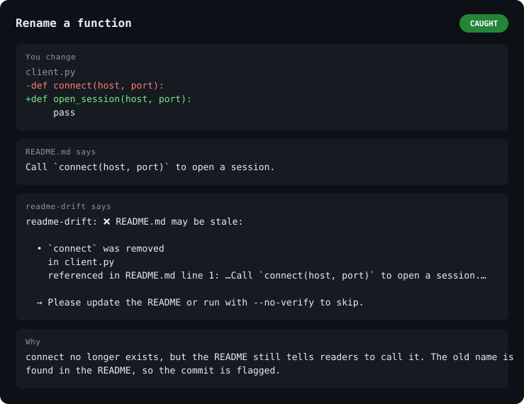
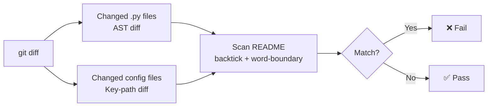

<p align="center">
  
</p>

[](https://pypi.org/project/readme-drift/)
[](https://pypi.org/project/readme-drift/)
[](https://pypi.org/project/readme-drift/)
[](https://sachn1.github.io/readme-drift/)

> Detect stale README references after code changes — for pre-commit and CI.

When you rename a function, change a method signature, remove a class, or rename a key in a config file, `readme-drift` warns you if those names are still referenced in your README — before the commit lands.

<p align="center">
  
</p>

---

## How it works



---

## Installation

```bash
pip install readme-drift
```

---

## Usage

### Start in warn-only mode

New to the tool? Don't let it block commits on day one. Run it in
warn-only mode for a week or two so it can prove its false-positive rate
on your repo before it earns the right to fail a build:

```yaml
repos:
  - repo: https://github.com/sachn1/readme-drift
    rev: v3.4.0 # use the latest release
    hooks:
      - id: readme-drift
        args: [--warn-only]
```

Once you've seen it flag real drift (and nothing but real drift) for a
while, drop `--warn-only` and let it block.

### As a pre-commit hook (recommended)

Add to your `.pre-commit-config.yaml`:

```yaml
repos:
  - repo: https://github.com/sachn1/readme-drift
    rev: v3.4.0 # use the latest release
    hooks:
      - id: readme-drift
```

Then install the hook:

```bash
pre-commit install
```

No extra `args` needed — the hook automatically checks your **staged** changes (what you've `git add`-ed). Do not pass `--staged` yourself; it's already set internally and duplicating it will cause an error.

### In CI (GitHub Actions)

As a step calling the CLI directly:

```yaml
- name: Check README staleness
  run: readme-drift --base-ref origin/${{ github.base_ref }}
```

CI compares committed changes against a base branch. Do not pass `--staged` here.

Or using the bundled composite action, which installs and runs it for you:

```yaml
- uses: actions/checkout@v4
  with:
    fetch-depth: 0 # required so origin/<base-branch> is fetchable

- uses: sachn1/readme-drift@v3.4.0
  with:
    warn-only: "true" # drop once you trust the signal
```

See [action.yml](action.yml) for all inputs (`base-ref`, `warn-only`, `include-private`, `exclude`, `readme-paths`, `verify`, `version`).

### As a CLI tool

```bash
readme-drift --staged                              # check staged changes
readme-drift --base-ref origin/main               # check against a branch
readme-drift --base-ref origin/main --warn-only   # warn but don't fail
readme-drift --init                                # scaffold an empty README (see below)
readme-drift --base-ref origin/main --verify      # also verify README commands against the repo
```

---

## Writing a drift-friendly README

> **Tip — use backticks for commands, names and anything code-like.** Wrap function and class names, config keys, CLI flags, file paths and shell commands in backticks (`` `make lint` ``, `` `Client.connect` ``, `` `--warn-only` ``). This is ordinary good documentation practice — it makes commands copyable and unambiguous for readers — and it is also what lets `readme-drift` match a changed name precisely, so it stays accurate and quiet. The first time you run the tool in a repository it prints this recommendation once (see [Configuration](#configuration) to silence it).

`readme-drift` matches symbols two ways: inside backtick spans (`` `Client.connect` ``) and, for longer names, as plain text. **Backtick references are the reliable channel** — plain-text matching exists as a convenience but is deliberately dampened by a [noise blocklist](https://sachn1.github.io/readme-drift/configuration/#noise-blocklist-default) and a minimum length, so common words don't turn every commit into a false positive.

A Python name that is a single lowercase word (`request`, `head`, `connect`) is an ordinary English word too, so it is matched only inside a backtick span that starts with it (`` `connect(host)` ``); names with an underscore, a capital or a dot (`send_payload`, `Client`) still match in prose. Config keys and Makefile targets are matched only inside backticks or code blocks, never in plain prose, because they are often ordinary words (`include`, `extras`). A key removed from a `.toml` file whose name still appears in the new file (for example a dependency moved to a new layout) is not reported.

A backtick span matches only the whole name: `` `connect(host)` `` and `` `Client.connect()` `` match `connect`, but `` `connection_pool` `` and `` `requests` `` do not.

A method symbol `Console.print` is also matched by an instance call written with the lowercase class name, such as `console.print(...)`.

Lines that pull in generated API docs (`::: pkg.name` for mkdocstrings, `.. autofunction:: pkg.name` and the other Sphinx `.. auto…::` directives) are ignored, because they are rebuilt from the code and cannot go stale.

Practical implication: if a public function, class, or config key is mentioned in prose without backticks (e.g. "call connect to open a session" instead of "call `` `connect` `` to open a session"), a rename of that symbol may pass the hook silently. This is a real detection gap, not a bug — treat backtick-wrapping your public API references as the thing that makes the hook actually work, not just a style preference.

If you're starting from scratch, `readme-drift --init` creates a bare-bones `README.md` with template subheadings (Installation, Usage, API Reference, License) and a reminder comment about backticks. It does not scan your code or generate documentation — it only refuses to run if a non-empty README already exists, so it's safe to run once and won't clobber real content.

---

## Verifying README commands (`--verify`)

By default `readme-drift` reacts to code changes. With `--verify` it also reads the shell commands in your README's fenced code blocks (`bash`, `sh`, `shell`, `zsh`, `console`, or untagged; in an untagged block only lines that start with `$ `, a path or a well-known command count, so pasted output such as `serviceaccount/x created` is ignored) and commands in **inline code spans** (`` `make build` `` in a sentence, including a span that wraps onto the next line) when they clearly are commands: `make` with a target, `npm`/`pnpm`/`yarn run`, `docker compose`, a Python or shell script with a file extension, or your own command followed by a flag. It then checks that the names **your repository owns** still exist — across every README in full, not just the diff:

<!-- readme-drift: ignore -->
| README says | Checked against |
|---|---|
| `make lint` | targets in the `Makefile` |
| `npm run build`, `yarn run x`, `pnpm run x` | `scripts` in `package.json` |
| `docker compose up web`, `docker compose -f ci/compose.yml run app` | services in the compose files (`compose.yaml` plus layered files such as `compose.override.yml`), and the named files |
| `readme-drift --base-ref …` (your own console script) | long options defined by the command, read statically from `[tool.poetry.scripts]` / `[project.scripts]` |
| `python scripts/x.py`, `python -m pkg.mod`, `bash x.sh`, `./run.sh` | the file or local module exists |
| `make -f x.mk`, `docker build -f F`, `kubectl apply -f x.yaml`, `helm … -f v.yaml` | the named file exists |

Commands in a nested README are checked against files next to that README first (its own `Makefile`, `package.json`, compose file or script), then against the repository root.

For your own console script, long options are read statically from `click` and `argparse` declarations. An unknown option after a subcommand (`mytool run --debug`) is reported as unverifiable, because it may belong to that subcommand, and so is a command whose options are not declared as literals.

Each command ends in one of three states: **verified**, **broken**, or **unverifiable**. Only *broken* fails the run. The tool never judges the syntax of third-party commands (`docker run -it`, `pip install`), and it reports anything uncertain — an `include` in a Makefile, a `cd` earlier in the block, a path in a build directory, placeholders like `<name>` or `$VAR` — as unverifiable rather than guessing.

```bash
readme-drift --base-ref origin/main --verify            # diff check + command verification
readme-drift --verify --verbose --warn-only             # list every check, never fail
```

To exempt a command that is intentionally different, put `<!-- readme-drift: ignore -->` on the line above a fenced block (skips the block) or above a single command inside it (skips that command). For prose, put it on the first line of the paragraph (or table) to skip all of it. It does not read 4-space indented code blocks, and names like `` `build` `` or `` `python 3.11` `` in a sentence are ignored because they do not clearly read as commands.

---

## Configuration

All CLI flags can be set permanently in `pyproject.toml` under `[tool.readme-drift]`.
CLI flags always take precedence over the file. See the [full configuration reference](https://sachn1.github.io/readme-drift/configuration/) for all options.

```toml
[tool.readme-drift]
base-ref = "origin/main"
warn-only = false
include-private = false
plain-text-search = true
min-symbol-length = 4
exclude = ["generated/", "tests/"]
symbol-allowlist = ["MyPublicClass"]
symbol-denylist = ["_internal"]
noise-blocklist = ["run", "build"]   # replaces built-in default; [] disables
noise-allowlist = ["run"]            # remove words from built-in (use instead of noise-blocklist)
readme-paths = []                    # explicit list; empty = auto-discover
readme-exclude-dirs = []
verify = false                       # also verify README shell commands against the repo
tips = true                          # one-time first-run backtick tip; false silences it
```

| Key | CLI flag | Default |
|---|---|---|
| `base-ref` | `--base-ref` | `"HEAD"` |
| `staged` | `--staged` | `false` |
| `warn-only` | `--warn-only` | `false` |
| `include-private` | `--include-private` | `false` |
| `plain-text-search` | `--plain-text-search` / `--no-plain-text-search` | `true` |
| `min-symbol-length` | `--min-symbol-length` | `4` |
| `exclude` | `--exclude` (repeatable) | `[]` |
| `symbol-allowlist` | `--symbol-allowlist` (repeatable) | `[]` |
| `symbol-denylist` | `--symbol-denylist` (repeatable) | `[]` |
| `noise-blocklist` | `--noise-blocklist` (repeatable) | built-in default |
| `noise-allowlist` | `--noise-allowlist` (repeatable) | `[]` |
| `readme-paths` | `--readme-paths` (repeatable) | `[]` (auto-discover) |
| `readme-exclude-dirs` | `--readme-exclude-dirs` (repeatable) | `[]` |
| `verify` | `--verify` | `false` |
| `verbose` | `--verbose` | `false` |
| `tips` | — (or env `README_DRIFT_NO_TIPS=1`) | `true` |

`pyproject.toml` is discovered by walking up from the current directory (or `--repo-root` if set). If no `[tool.readme-drift]` section is present, all defaults apply.

---

## Developer reference

A fully annotated [Jupyter notebook](notebooks/demo.ipynb) walks through each module in depth — AST parsing, signature extraction, config diffing, the README scanner, README command verification (`--verify`), and the complete end-to-end pipeline without git. Useful for understanding the internals or experimenting with edge cases.

---

## Example output

```
readme-drift: ❌ README.md may be stale:

  • `Client.connect` signature changed: connect(host, port) → connect(url)
    in src/client.py
    referenced in README.md line 42: …call `Client.connect(host, port)` to connect…

  • `build` was removed
    in package.json
    referenced in README.md line 18: …run `npm run build` to compile…

  → Please update the README or run with --no-verify to skip.
```

---

## See it in practice

More scenarios, including what it misses and where it can raise false alarms, are in the [gallery](https://sachn1.github.io/readme-drift/scenarios/).

---

## What it catches

### Python files (`.py`)

| Change | Detected? |
|---|---|
| Function renamed | ✅ old name flagged as removed |
| Function removed | ✅ |
| Method signature changed | ✅ |
| Class removed | ✅ |
| Private symbol changed (`_name`) | ➖ ignored by default (enable with `--include-private`) |
| README updated alongside code | ✅ passes silently |
| No Python files changed | ✅ skipped |

### Config files (`.yml`, `.yaml`, `.json`, `.toml`)

| Change | Detected? |
|---|---|
| Script key removed (`"build"` → gone) | ✅ |
| Job name removed (`build:` → gone) | ✅ |
| Tool section removed (`[tool.black]` → gone) | ✅ |
| Key renamed at same level | ✅ (reported as remove + add) |
| Value changed, key unchanged | ➖ not tracked |
| Lockfile changed (`package-lock.json`, `pnpm-lock.yaml`, `poetry.lock`, `uv.lock`, `Cargo.lock`, `Pipfile.lock`, …) | ➖ ignored: generated, and a single `npm install` would produce thousands of meaningless names |

### `Makefile` / `makefile` / `GNUmakefile`

| Change | Detected? |
|---|---|
| Target removed (`deploy:` → gone) | ✅ |
| Target renamed | ✅ (reported as remove + add) |
| Recipe body changed, target name unchanged | ➖ not tracked |
| Variable assignments (`VAR := ...`) | ➖ not tracked |
| `.PHONY` declaration | ➖ ignored (bookkeeping, not a callable target) |

## What it doesn't catch

- Command syntax of third-party tools (`docker run -it`, `pip install`); `--verify` only checks names your repo defines
- Behavioral changes that don't affect the public API or config surface
- Symbols not mentioned in the README

---

## Supported README formats

Any file named `readme` (case-insensitive) with the extension `.md`, `.markdown`, `.rst`, `.txt`, or no extension is scanned. All README files in the repository are discovered recursively, including per-package READMEs in monorepos.

**Each README covers its own folder.** A README in a subfolder (say `services/cart/README.md`) is checked against changes under that folder and against files in the folders above it (the root `Makefile` or `compose.yaml` it tells you to run), but not against other services' folders, so a removed key in one service's config does not flag another service's README. The root README is global and is checked against every change, as is any README you name with `--readme-paths`. One exception keeps real drift from slipping through: an exact backtick reference to a distinctive name (at least four characters, not a common word) is checked wherever the change happened. Run with `--verbose` to see when a name was skipped because it only appeared in READMEs of other folders.

Inside a README, names are matched in backtick spans, as plain text, and inside ` ```mermaid ` blocks that start with `classDiagram`. In a class diagram, matching follows the diagram's structure: a class name matches that class, and `Class.method` matches only inside that class's block, so short or everyday names like `run` still work. Functions and config keys never match through a diagram. Other mermaid diagram types (flowcharts and so on) are ordinary prose.

The following directories are never searched:

`.git` · `node_modules` · `venv` · `.venv` · `.tox` · `__pycache__` · `.pytest_cache` · `dist` · `build` · `.mypy_cache`

---

## License

MIT
