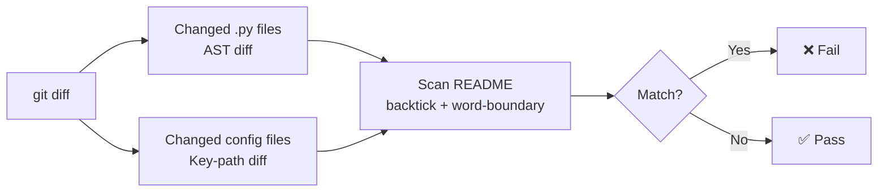

# readme-drift

[](https://pypi.org/project/readme-drift/)
[](https://pypi.org/project/readme-drift/)
[](https://pypi.org/project/readme-drift/)

> Detect stale README references after code changes — for pre-commit and CI.

When you rename a function, change a method signature, remove a class, or rename a key in a config file, `readme-drift` warns you if those names are still referenced in your README — before the commit lands.

## How it works



## Quick start

```bash
pip install readme-drift
```

Add to `.pre-commit-config.yaml`:

```yaml
repos:
  - repo: https://github.com/sachn1/readme-drift
    rev: v3.4.0 # use the latest release
    hooks:
      - id: readme-drift
```

See [Usage → Pre-commit hook](usage/pre-commit.md) for full setup, and [Usage → CI](usage/ci.md) for GitHub Actions integration.

!!! tip "Start in warn-only mode"
    New to the tool? Add `args: [--warn-only]` to the hook for a week or two so it can prove its false-positive rate on your repo before it is allowed to fail a commit. Drop the argument once it only ever flags real drift.

!!! tip "Use backticks for commands, names and paths"
    Wrap function and class names, config keys, CLI flags, file paths and shell commands in backticks (`` `make lint` ``, `` `Client.connect` ``). It is good documentation practice, and it is what keeps `readme-drift` accurate. The first run in a repository prints this tip once; silence it with `tips = false` or `README_DRIFT_NO_TIPS=1`.

See [How it works in practice](scenarios.md) for concrete examples, including where it misses and where it can raise false alarms.

## What it catches

### Python files

| Change | Detected? |
|---|---|
| Function renamed | ✅ old name flagged as removed |
| Function removed | ✅ |
| Method signature changed | ✅ |
| Class removed | ✅ |
| Private symbol changed (`_name`) | ➖ ignored by default (enable with `--include-private`) |
| README updated alongside code | ✅ passes silently |

### Config files (`.yml`, `.yaml`, `.json`, `.toml`)

| Change | Detected? |
|---|---|
| Script key removed | ✅ |
| Job name removed | ✅ |
| Tool section removed | ✅ |
| Key renamed at same level | ✅ reported as remove + add |
| Value changed, key unchanged | ➖ not tracked |

### `Makefile` / `makefile` / `GNUmakefile`

| Change | Detected? |
|---|---|
| Target removed | ✅ |
| Target renamed | ✅ reported as remove + add |
| Recipe body changed, target name unchanged | ➖ not tracked |

## Where it looks in the README

Names are matched in backtick spans, as plain text, and inside ` ```mermaid ` blocks that start with `classDiagram`. In a class diagram, matching follows the diagram's structure: a class name matches that class, and `Class.method` matches only inside that class's block, so short or everyday names like `run` still work. Functions and config keys never match through a diagram. Other mermaid diagram types (flowcharts and so on) are ordinary prose.

### README commands (opt-in)

With `--verify`, shell commands in README code blocks are checked against names the repo owns — `make` targets, `package.json` scripts, compose services, paths, local modules and the project's own CLI flags. See [Usage → CLI reference](usage/cli-reference.md#-verify).

## What it doesn't catch

- Behavioral changes that don't affect the public API or config surface
- Symbols not mentioned in the README
