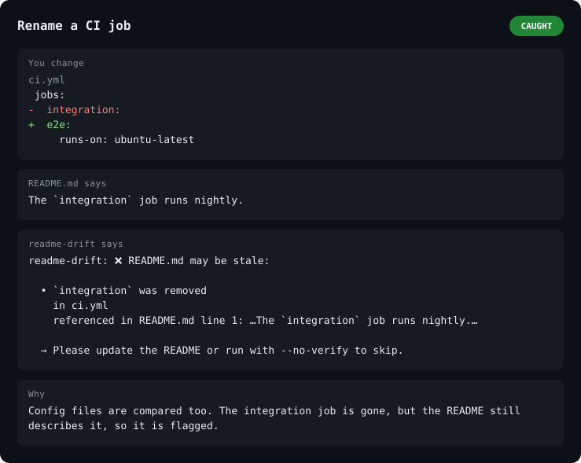
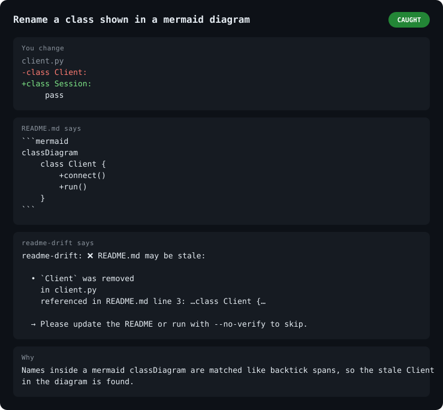
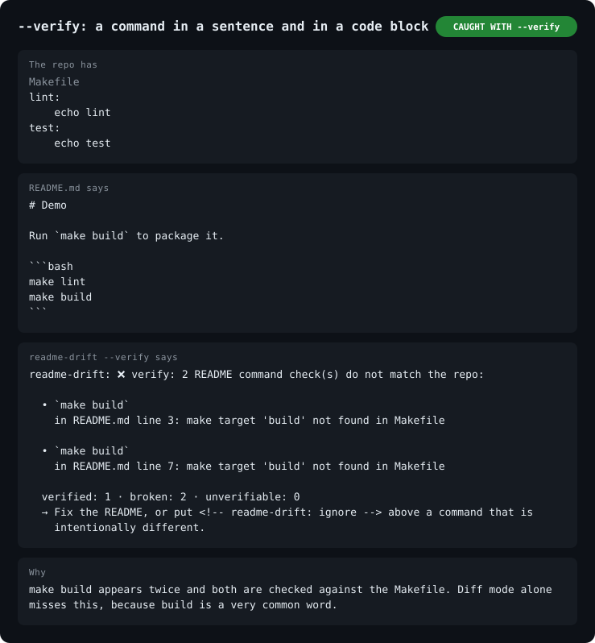
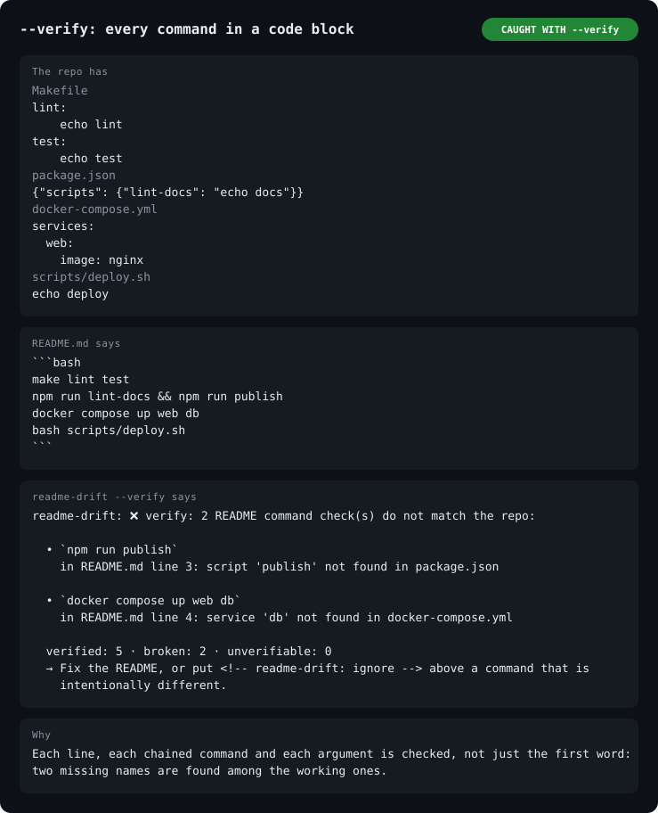
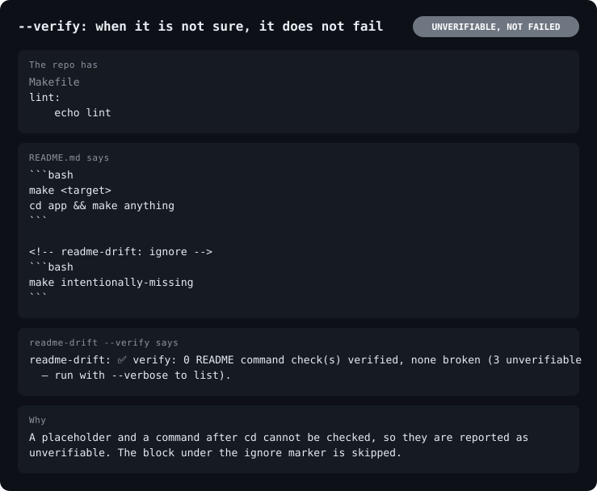

# How it works in practice

Each image is generated from a real run of the tool. A test fails if one goes stale.

## What the default check does not catch

## Check the commands too: `--verify`

The default check reacts to names that changed in your diff. `--verify` reads the commands in your README, in code blocks and in sentences, and checks them against what the repo defines.

