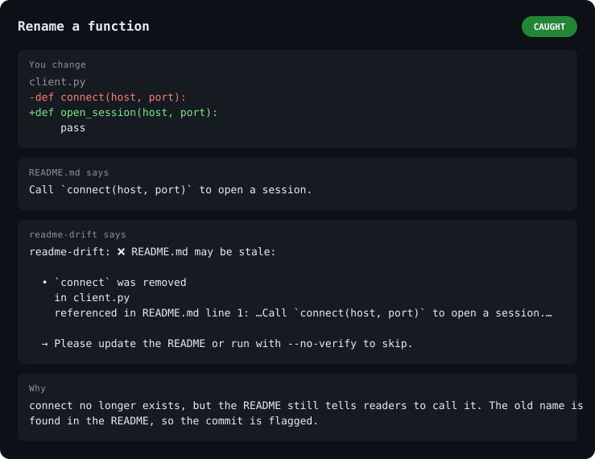
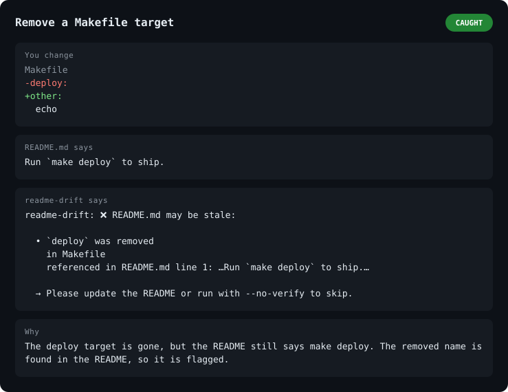
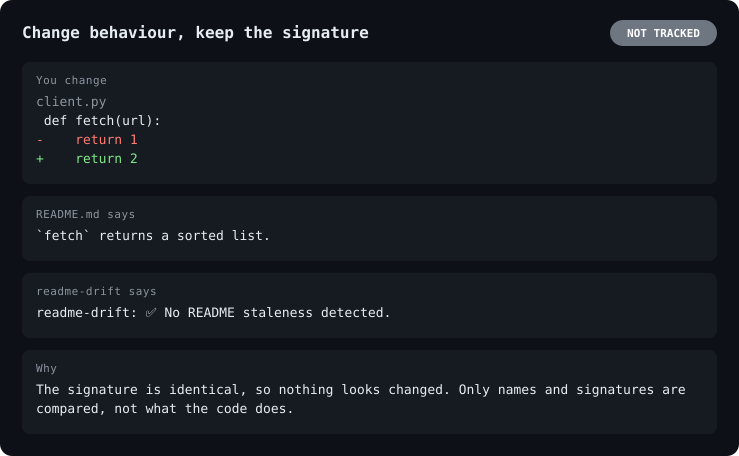
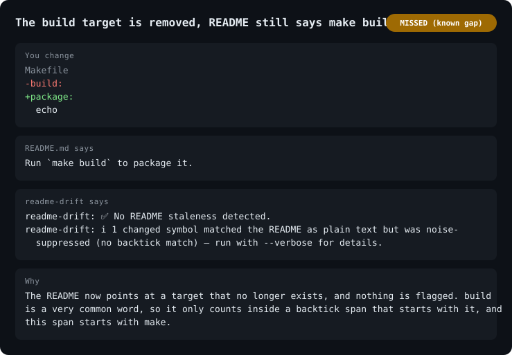
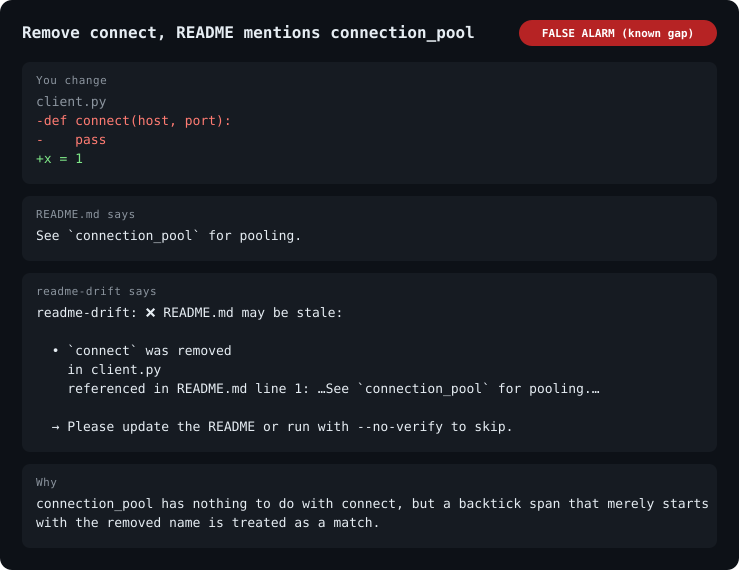

# How it works in practice

Each image is generated from a real run of the tool. A test fails if one goes stale.

## What it does not catch

Fix: `--noise-allowlist build`, or give the bare name its own backtick span.

Fix: `symbol-denylist = ["connect"]`.
